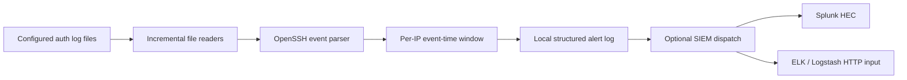
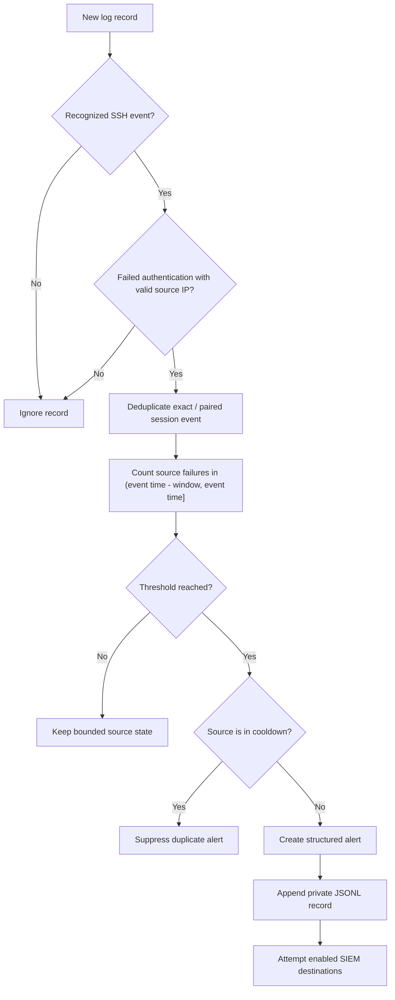

# SSH Intrusion Detection System

A Python-based defensive monitor for Linux OpenSSH authentication logs. It parses SSH events, detects per-source bursts of failed authentication using event timestamps, records JSON alerts locally, and can forward alerts to Splunk HEC and Logstash.

This repository also contains a separate Next.js UI component scaffold. It has no IDS dashboard route or connection to the Python service; the supported, tested application is the Python IDS.

## Problem and scope

Repeated SSH authentication failures are a useful signal for brute-force activity. This project provides a small, configurable log-based detector for lab demonstrations and defensive monitoring. It does **not** attribute attackers, block IPs, change firewall rules, or generate real network traffic.

The implementation has not been certified as production-ready. Review the [known limitations](#known-limitations) and validate the configuration and access controls in your environment before operational use.

## Architecture



## Detection workflow



### Key features

- Reads one or more configured Linux authentication logs.
- Parses failed and successful authentication, connection, timeout, protocol, and negotiation events.
- Detects failed-authentication bursts by source IP using a configurable threshold and event-time window.
- Excludes exactly-on-boundary events from the active window: the interval is `(event time - window, event time]`.
- Handles appended records, missing files, truncation, and inode replacement; initial read can start at the beginning or end.
- Keeps bounded, independent per-IP state and suppresses repeat alerts for a configurable cooldown.
- De-duplicates identical raw records during the current process while preserving distinct SSH attempts.
- Bounds each read cycle and retained alert history to avoid unbounded in-memory growth.
- Emits structured alerts to a private local JSONL file even when SIEMs are disabled or delivery fails.
- Supports Splunk HEC and Logstash HTTP JSON delivery with timeouts, TLS verification, and bounded retries.
- Validates Splunk HEC response JSON and requires a successful HEC `code: 0`, not just HTTP 200.
- Provides a local-only, non-network attack simulator that refuses protected system authentication logs.

## Technology stack

- Python 3.10+; core runtime uses only the standard library.
- `pytest`, `pytest-cov`, Ruff, mypy, and Bandit for development checks.
- Optional Splunk HTTP Event Collector and Logstash HTTP input integrations.
- A separate Next.js 16 / React 19 UI component scaffold (not an IDS dashboard).

## Repository structure

```text
ssh_ids/
  config/config.json       Application configuration
  src/                     Python package and canonical CLI entry point
  tests/                   Automated tests, sample log, safe simulator
install.sh                 Creates a local virtual environment
run.sh                     Starts the configured Python application
requirements.txt           Runtime dependencies (standard library only)
requirements-dev.txt       Test and quality-check tools
AUDIT.md                   Repository audit and verification evidence
docs/                      Architecture, testing, setup, SIEM, and demo guides
.github/workflows/ci.yml   Python tests, coverage, lint, typing, and security lint
app/, components/, hooks/  Separate Next.js UI scaffold
```

## Ubuntu installation

Install Python, venv support, and Git:

```bash
sudo apt update
sudo apt install -y python3 python3-venv git
git clone https://github.com/anurag-rvnkr1/SSH-Intrusion-Detection-System.git
cd SSH-Intrusion-Detection-System
python3 -m venv .venv
source .venv/bin/activate
python -m pip install -r requirements.txt
```

The runtime has no third-party dependencies. To install test and quality tools:

```bash
python -m pip install -r requirements-dev.txt
```

Alternatively, `./install.sh` creates `.venv` and installs runtime requirements. It does not need `sudo` and does not change system logs. Do not run `install.sh` with `sudo`.

## Configuration

Edit [`ssh_ids/config/config.json`](./ssh_ids/config/config.json). The checked-in configuration monitors `/var/log/auth.log` and `/var/log/secure`, starts at the end of existing files, polls every five seconds, and has SIEM delivery disabled.

Important fields:

| Setting | Meaning |
|---|---|
| `detection.alert_threshold` | Failed events per source IP required for an alert; default `5`. |
| `detection.window_minutes` | Event-time rolling window; default `2`, maximum `10080` minutes. |
| `detection.cooldown_seconds` | Per-IP alert suppression interval; default `120`, maximum `2592000` seconds. |
| `detection.future_tolerance_seconds` | Permitted clock skew; default `60`, maximum `86400` seconds. |
| `detection.max_tracked_ips` | Maximum source-IP states retained (`1`–`65536`); excess states evict the least-recently-used IP. |
| `detection.max_events_per_ip` | Maximum events per source (`1`–`4096`); must meet the threshold and combined state is capped at one million events. |
| `detection.max_alert_history` | Maximum recent alerts retained in memory (`1`–`10000`); default `1000`. |
| `polling.log_files` | One or more paths. Relative paths resolve from the config file's directory. |
| `polling.initial_read` | `end` ignores pre-existing records; `beginning` processes them. |
| `polling.interval_seconds` | Polling interval from greater than zero through `3600` seconds. |
| `polling.max_bytes_per_poll` | Maximum log bytes read from each file per cycle; total across configured files is capped at 64 MiB. Default `1048576`. |
| `alerts.local_file` | Private append-only JSONL alert history; relative paths resolve from the config file. |

JSON example (comments are not valid JSON):

```json
{
  "detection": {
    "alert_threshold": 5,
    "window_minutes": 2,
    "cooldown_seconds": 120,
    "future_tolerance_seconds": 60,
    "max_tracked_ips": 1024,
    "max_events_per_ip": 256,
    "max_alert_history": 1000,
    "log_level": "INFO"
  },
  "polling": {
    "interval_seconds": 5,
    "max_bytes_per_poll": 1048576,
    "initial_read": "end",
    "log_files": ["/var/log/auth.log"]
  },
  "siem": {"splunk": {"enabled": false}, "elk": {"enabled": false}},
  "alerts": {"local_file": "../data/alerts.jsonl"}
}
```

The configured JSONL alert file is created as user-owned mode `0600` in a private mode `0700` directory. The default checked-in path resolves to `ssh_ids/data/alerts.jsonl`, which is ignored by Git. Alert records persist across process restarts in this file. Detection attempts, cooldown timestamps, duplicate-record fingerprints, and the in-memory recent-alert buffer do not persist; replaying a log from its beginning after restart can generate another alert.

The loader validates types and ranges, resolves relative paths against the config file, and expands `${ENVIRONMENT_VARIABLE}` expressions. It does not automatically read a `.env` file. Use the supplied [`.env.example`](./.env.example) as a reminder; keep actual values in the shell or a secret manager:

```bash
read -rsp "Splunk HEC token: " SPLUNK_HEC_TOKEN
export SPLUNK_HEC_TOKEN
printf '\n'
```

Do not put real credentials in JSON, source control, or command-line arguments. Missing environment variables for configured placeholders and missing credentials for enabled integrations fail at startup without printing token values.

## Run the application

Canonical module execution from the repository root:

```bash
python3 -m ssh_ids.src.main --config ssh_ids/config/config.json
```

With the virtual environment:

```bash
.venv/bin/python -m ssh_ids.src.main --config ssh_ids/config/config.json
```

The CLI also supports `--test-mode`, `--log-file PATH`, `--verbose`, `--version`, and `--help`. `--test-mode` reads the supplied dedicated test file from its beginning and refuses `/var/log/auth.log`, `/var/log/secure`, and their resolved aliases. The normal mode reads the configured authentication logs and uses `initial_read`.

`./run.sh` launches the same module and works from any current directory. The application does not need root privileges to parse readable files.

### Least-privilege access to Ubuntu authentication logs

On Ubuntu, `/var/log/auth.log` is commonly readable by the `adm` group. Check the actual owner and mode first:

```bash
ls -l /var/log/auth.log
```

Only with host-administrator approval, grant the intended account read access
through the existing log-reader group; membership may expose other system logs.
After an approved group change, sign out and back in:

```bash
sudo usermod -aG adm "$USER"
```

Do not run the detector or simulator as root just to bypass permissions. If your system uses a different group or journald-only logging, configure a deliberate read-only access method and a supported file source.

## Safe local test and simulator

The simulator writes **only local synthetic log records**. It does not attempt SSH connections or send packets. The default destination is `/tmp/ssh-ids-test/auth_simulation.log`; output creation is exclusive, uses mode `0600`, and refuses to overwrite an existing file or write to protected system authentication logs. Use a unique output path for repeated demonstrations.

Safest repeatable end-to-end demo:

```bash
TEST_DIR="$(mktemp -d)"
python3 -m ssh_ids.tests.simulate_attacks \
  --test-mode --log-file "$TEST_DIR/auth_simulation.log" \
  --source-ip 198.51.100.25 --username root \
  --attempts-per-attack 5 --seed 17
python3 -m ssh_ids.src.main --test-mode --log-file "$TEST_DIR/auth_simulation.log"
```

The detector prints a local structured alert when it reaches the default threshold. Stop it with Ctrl+C. `TEST_DIR` is a private temporary directory; remove it yourself after reviewing the data if desired.

Print records without writing any file:

```bash
python3 -m ssh_ids.tests.simulate_attacks \
  --print-only --scenario brute-force --source-ip 198.51.100.25 \
  --username admin --attempts-per-attack 5 --seed 17
```

Other supported scenarios are `successful-login` and `preauth-scan`. You can supply repeated `--source-ip` and `--username` options, set `--num-attacks`, `--window-seconds`, or choose an explicit `--log-file`. A random seed makes generated random values reproducible; use a fixed `--start-time` through the Python API for byte-for-byte repeatability across runs.

Never use `sudo` with the simulator. The program blocks canonical, rotated, and symlink-resolved aliases of `/var/log/auth.log` and `/var/log/secure`.

## SIEM integrations

### Splunk HTTP Event Collector

1. Create an HEC token in Splunk and enable the HEC listener.
2. Export the token as `SPLUNK_HEC_TOKEN`.
3. Configure the `splunk` section:

```json
"splunk": {
  "enabled": true,
  "url": "https://splunk.example:8088",
  "token": "${SPLUNK_HEC_TOKEN}",
  "ssl_verify": true,
  "timeout_seconds": 5,
  "max_attempts": 3,
  "retry_backoff_seconds": 0.5
}
```

The sender posts to `/services/collector` with an `Authorization: Splunk ...` header and a JSON HEC envelope. Certificate validation stays enabled by default; do not disable it to work around certificate errors.

### ELK / Logstash

Configure a Logstash HTTP input and set its endpoint:

```json
"elk": {
  "enabled": true,
  "url": "https://logstash.example:8080",
  "ssl_verify": true,
  "timeout_seconds": 5,
  "max_attempts": 3,
  "retry_backoff_seconds": 0.5,
  "headers": {"X-Api-Key": "${LOGSTASH_API_KEY}"}
}
```

The sender posts the alert as JSON. Use HTTPS and a protected secret source for non-local Logstash. The endpoint must be reachable and configured to accept HTTP JSON events.

Network errors and transient HTTP statuses (408, 425, 429, and 5xx) receive bounded exponential backoff; permanent client errors are not retried. One failed SIEM does not stop local alert logging or delivery attempts to other configured destinations. Disabled integrations are not reported as delivery failures.

## Example alert

```json
{
  "alert_id": "4ae7dc56-0c55-43c0-85c6-37931792a526",
  "timestamp": "2026-11-01T07:26:40+00:00",
  "event_timestamp": "2026-11-01T07:26:40+00:00",
  "detected_at": "2026-11-01T07:26:42+00:00",
  "source_ip": "198.51.100.25",
  "username": "root",
  "attempts": 5,
  "threshold": 5,
  "detection_rule": "ssh_failed_authentication_burst",
  "attack_type": "SSH Brute Force",
  "severity": "High",
  "hostname": "ubuntu",
  "host": "ubuntu",
  "log_source": "/tmp/ssh-ids-test/auth_simulation.log",
  "detection_window_minutes": 2.0,
  "failure_types": ["failed_password"],
  "event_details": [
    {
      "timestamp": "2026-11-01T07:26:40+00:00",
      "username": "root",
      "failure_type": "failed_password",
      "source_port": 54123
    }
  ]
}
```

The example is illustrative; IDs, timestamps, hostname, and event details are generated from each run. Source IPs identify the logged peer address only, not a person or attribution.

Example terminal output:

```text
2026-11-01 07:26:42 - ssh_ids - INFO - Starting local test logs; monitoring: /tmp/.../auth_simulation.log
2026-11-01 07:26:42 - ssh_ids.src.detector - WARNING - SSH brute-force alert: 5 attempts from 198.51.100.25
2026-11-01 07:26:42 - ssh_ids - WARNING - SSH IDS alert: {"alert_id": "...", "attempts": 5, ...}
```

## Tests and quality checks

From the repository root, with `requirements-dev.txt` installed:

```bash
# Complete suite
python3 -m pytest

# One test module
python3 -m pytest ssh_ids/tests/test_detection.py -v

# Coverage for core behavior
python3 -m pytest \
  --cov=ssh_ids.src.utils \
  --cov=ssh_ids.src.parser \
  --cov=ssh_ids.src.detector \
  --cov=ssh_ids.src.sender \
  --cov=ssh_ids.src.alert_store \
  --cov=ssh_ids.tests.simulate_attacks \
  --cov-report=term-missing \
  --cov-fail-under=90

# Lint, type, and security checks
ruff format --check ssh_ids
ruff check ssh_ids
mypy ssh_ids/src
bandit -r ssh_ids/src
```

Tests use temporary directories, deterministic timestamps, and mocked HTTP; they do not need root, a network connection, or SIEM credentials. The GitHub Actions workflow runs Python 3.10–3.14, Ruff, mypy, Bandit, and coverage with a 90% minimum for the core modules. A workflow is configured but its result must be checked on GitHub after publication.

### Latest local verification

On 2026-11-01, the full suite passed **140 tests** with **95.30% aggregate
coverage** on Python 3.14.2. Ruff formatting/lint, mypy, Bandit, CLI/config
smoke checks, and installation plus tests in a clean virtual environment also
passed. The GitHub workflow has not been run remotely. The frontend TypeScript
check passed, but its build produced only `/404`, and `npm run lint` could not
run because ESLint is not installed; these results do not indicate a working
IDS dashboard.

## Troubleshooting

**No alerts in test mode**

- Confirm the simulator wrote the path passed to `--log-file`.
- Use `--attempts-per-attack` equal to or above `detection.alert_threshold`.
- Ensure generated events are within `detection.window_minutes`.
- Ensure the event timestamps are not beyond the configured future tolerance.

**No alerts monitoring real logs**

- Verify `polling.log_files`, `polling.initial_read`, and SSH daemon logging.
- Check read access with `ls -l` and run the detector as an account with least-privilege read access.
- Use `--verbose` for parser and reader diagnostics.

**SIEM delivery errors**

- Verify endpoint, listener, token environment variable, and TLS certificates.
- Inspect local application logs for destination and HTTP status; credentials are not logged.
- Check your SIEM-side listener logs and confirm it accepts the configured event payload.

**Simulator says file already exists**

It intentionally refuses to overwrite. Choose another filename or a fresh `mktemp -d` directory.

## Security considerations

- Simulator writes are synthetic local files only. It never writes to `/var/log/auth.log` or `/var/log/secure`, never requires root, and never opens an SSH connection.
- Monitoring files is read-only. Do not make authentication logs world-readable; prefer appropriate existing log groups or another least-privilege mechanism.
- SIEM TLS verification defaults to enabled. Avoid putting tokens in URLs or checked-in files.
- The application has no automated blocking or destructive response actions.
- Alert JSONL records are persistent, but detection and cooldown state are in memory only. Exact-record deduplication applies only for the current process.

## Known limitations

- Monitoring is polling-based, not kernel/event-stream based.
- Traditional syslog timestamps omit year and timezone; they are interpreted in the host's local timezone and assigned the current year. ISO timestamps with offsets are preferred for historical replay.
- The reader drains the old open inode when it detects rotation, but a writer racing with a rename cannot be guaranteed lossless across every logrotate policy.
- Per-IP state is bounded to configured IP and event limits; event counts above the per-IP cap saturate at the retained limit.
- Cooldown suppresses alerts for an IP while activity continues; cooldown and detection state reset on restart, but local JSONL alert records remain.
- SIEM delivery is synchronous and may delay polling up to the configured per-destination timeouts and retries.
- Local JSONL history is append-only and bounded only by available disk space; rotate/archive it according to local retention policy.
- The Next.js files are UI primitives only. No dashboard, alert-history API, or persistence layer is implemented.

## Future enhancements

- Durable SQLite alert history and restart-safe deduplication.
- More SSH-specific correlation rules and configurable per-event thresholds.
- A dashboard/API integrated with a durable alert store.
- Operational packaging and service deployment after least-privilege and rotation behavior are validated in target environments.

## Frontend workstream (not implemented)

The Next.js scaffold has no application page, IDS API client, or live data.
Building the dashboard is a separate workstream; do not treat UI primitives or
the current `/404` build output as a monitoring interface. A realistic
implementation should proceed in this order:

1. Define and test a Python API boundary over a durable alert store: service
   health, paginated/filterable alert history, and derived source-IP,
   username, severity, and timeline summaries. Validate query limits and
   response schemas.
2. Protect the API before exposing it beyond localhost: authenticated,
   authorized access, TLS at the deployment boundary, and no endpoints that
   accept arbitrary filesystem paths or unrestricted configuration writes.
3. Implement the Next.js status, metrics, recent-alert table, source/user
   summaries, timeline, search, and filters using only API responses, with
   explicit loading, empty, and error states.
4. Add API authentication/authorization tests and UI tests for filtering,
   empty/error behavior, and accessible keyboard/screen-reader interaction;
   verify end-to-end data against the running IDS before describing it as live.

## Interview talking points

- Explain the event-time window boundary and how out-of-order events are
  handled, rather than describing it as a wall-clock counter.
- Distinguish persistent JSONL alert history from in-memory detection,
  cooldown, and deduplication state.
- Show how temporary fixtures, protected-path checks, and mocked SIEM calls
  make the demonstration safe and reproducible.
- Discuss least-privilege log access, bounded reads/state, TLS verification,
  and why SIEM delivery failures do not stop local alert recording.
- Be candid that the UI is a scaffold, SIEM tests are mocked, and the project
  has not been validated on an Ubuntu 24.04 host or in production.

## Release readiness notes

- No `LICENSE` file is present. Select and add a license deliberately before
  inviting reuse or contributions; no license has been assumed here.
- CI is configured for Python 3.10–3.14, but this workspace validation does not
  prove a GitHub-hosted workflow run.

## Operator and engineering guides

- [Architecture](./docs/ARCHITECTURE.md)
- [Testing and validation](./docs/TESTING.md)
- [Ubuntu setup and least privilege](./docs/UBUNTU_SETUP.md)
- [Splunk and Logstash integration](./docs/SIEM_INTEGRATION.md)
- [Safe end-to-end demo walkthrough](./docs/DEMO_WALKTHROUGH.md)
