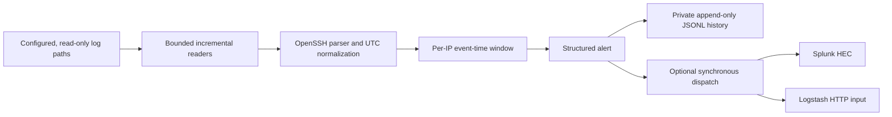

# Architecture

## Scope

The supported IDS is the Python package under `ssh_ids/`. The Next.js files at
the repository root are a separate UI component scaffold; they do not call the
Python process or display alerts.

## Event and alert flow

1. The CLI loads JSON configuration, expands `${NAME}` references from the
   process environment, validates values, and resolves relative paths against
   the configuration file.
2. One reader is created for each distinct configured log path. Reads are
   bounded by `polling.max_bytes_per_poll`; records larger than 8192 bytes are
   skipped. The reader retains partial records and handles missing files,
   truncation, and inode replacement.
3. The parser accepts recognized OpenSSH records, validates peer addresses
   using `ipaddress`, and normalizes timestamps to UTC. Successful logins,
   connection events, and security events are not counted as failed
   authentications.
4. The detector stores failures per source IP and evaluates event-time windows
   using `(event_time - window, event_time]`. Exact repeats of the same raw
   record are ignored in that process; paired invalid-user/failure records are
   also correlated when session metadata matches. A per-IP cooldown suppresses
   repeat alerts.
5. Generated alerts are appended to a private JSONL file before SIEM delivery.
   Each enabled destination is attempted independently. Disabled destinations
   are not failures.

## State and restart semantics

| State | Location | Survives restart? |
|---|---|---|
| Alert records | Configured `alerts.local_file` JSONL | Yes, until the file is rotated or removed |
| Per-IP attempts and event-time watermark | Process memory | No |
| Alert cooldown | Process memory | No |
| Exact-record deduplication | Bounded per-IP process state | No |
| Recent-alert convenience history | Bounded process-memory deque | No |
| SIEM counters | Process memory | No |

Consequently, a restarted detector configured with `initial_read: beginning`
can replay old failures and append new alerts for an attack already present in
the JSONL history. The history is not used as a durable deduplication database.

## Resource and trust boundaries

- Configuration limits the number of log files and caps aggregate reads at
  64 MiB per poll. Each retained record is at most 8192 bytes; tracker state
  cannot exceed one million events; recent alert history and SIEM retries are
  also capped.
- Simulator output is restricted to a dedicated local file; it does not send
  traffic and refuses canonical, rotated, and resolved authentication-log
  paths.
- Log content, usernames, source addresses, and SIEM responses are untrusted.
  The parser bounds and sanitizes records; alerts do not claim attribution.
- Authentication logs are only read. Access policy is delegated to the host;
  the program does not chmod logs or require root.

## Important limitations

The reader is polling-based. It drains an old open inode after rotation, but a
writer racing with a rename cannot be guaranteed lossless under every rotation
policy. Yearless syslog records are interpreted in the host's local timezone
and assigned the current year. SIEM delivery is synchronous and may delay
polling up to the configured retry/timeout budget.
